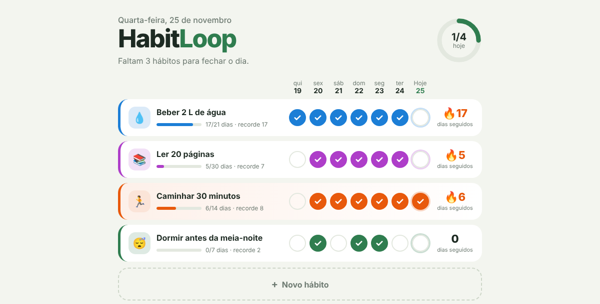

# HabitLoop — Hábitos diários

Acompanhe hábitos diários com check-in visual, sequência de dias seguidos e alertas de metas atingidas.

🔗 **[Ver o site no ar](https://iamviniciuslima05.github.io/PROJETO-HabitLoop/)**



## Funcionalidades

- **Check-in** dos últimos 7 dias com um toque
- **Sequência atual** e **recorde** de cada hábito
- **Meta de sequência** (7, 21, 30, 66 dias…) com barra de progresso
- **Alertas** de marcos e metas atingidas, com confete
- Anel com o **progresso do dia**
- **Mapa de calor** das últimas 12 semanas
- Ícone e cor para cada hábito
- Tudo salvo no **localStorage**

## Tecnologias

HTML5 · CSS3 · JavaScript · Canvas · localStorage

## Estrutura

```
index.html
css/style.css
js/script.js
```

## Como rodar

Não precisa instalar nada: baixe o projeto e abra o `index.html` no navegador, ou acesse a versão publicada acima.

---
Feito por **Vinicius Lima** · [Portfólio](https://viniciuslimadev.netlify.app) · [LinkedIn](https://www.linkedin.com/in/viniciuslima25/)
